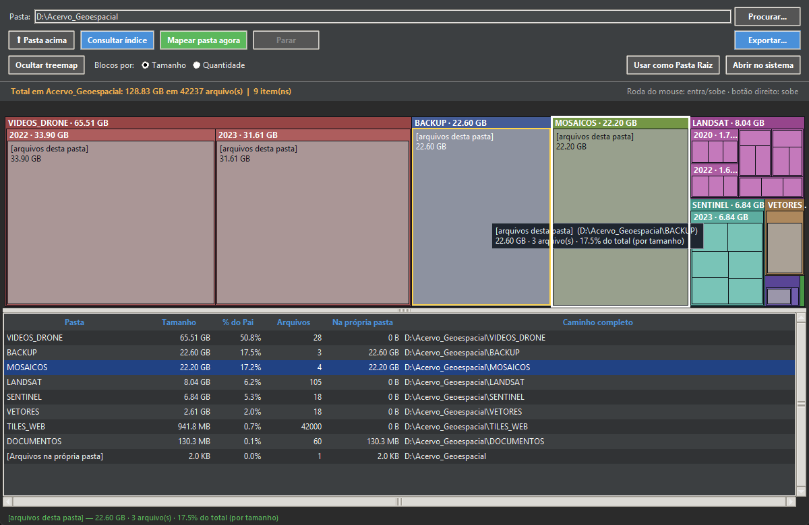
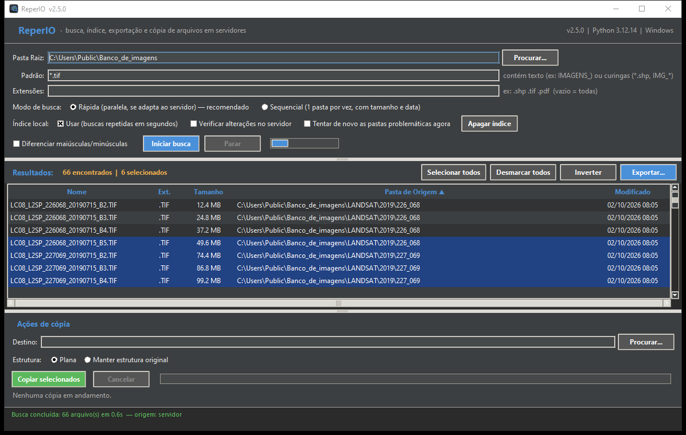
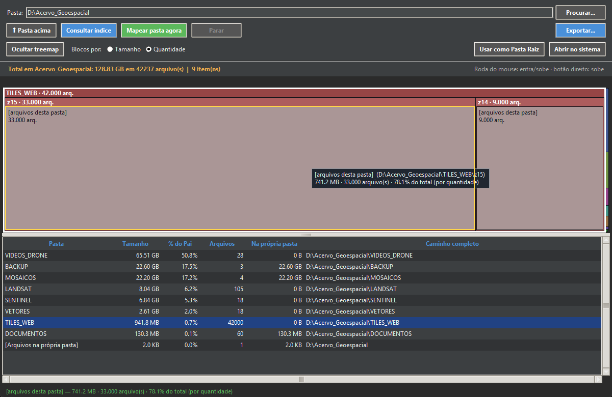
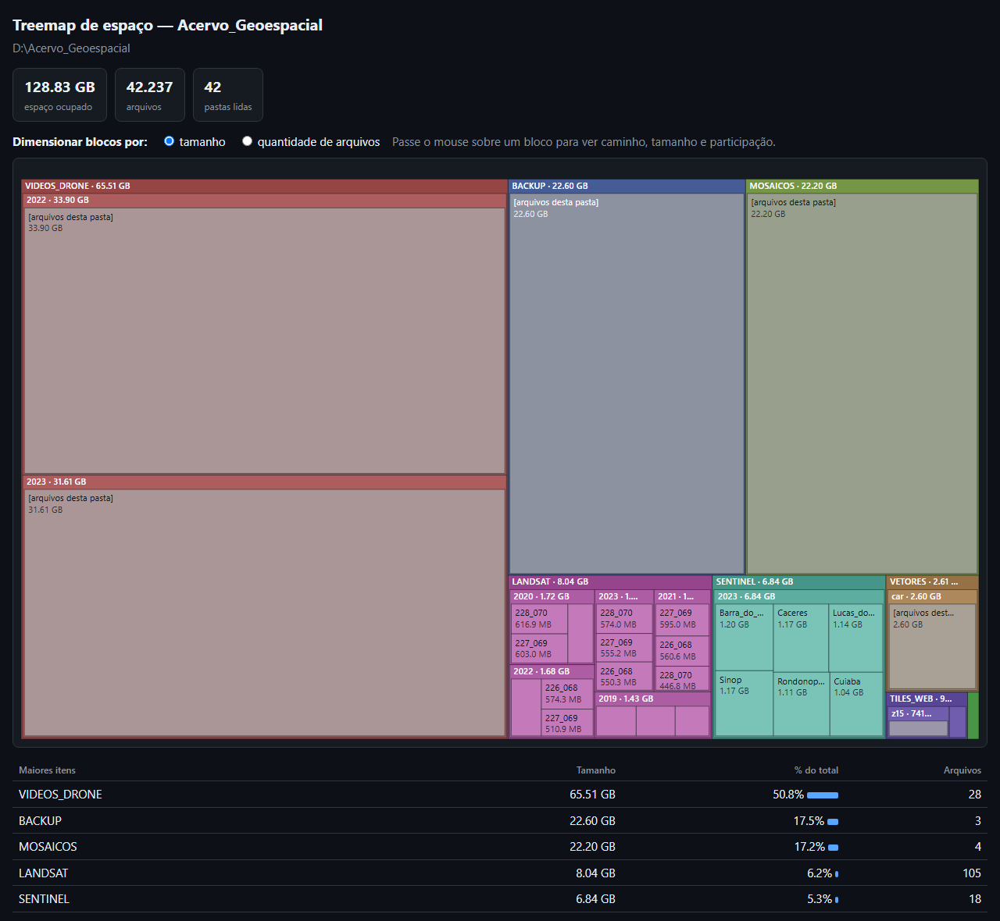
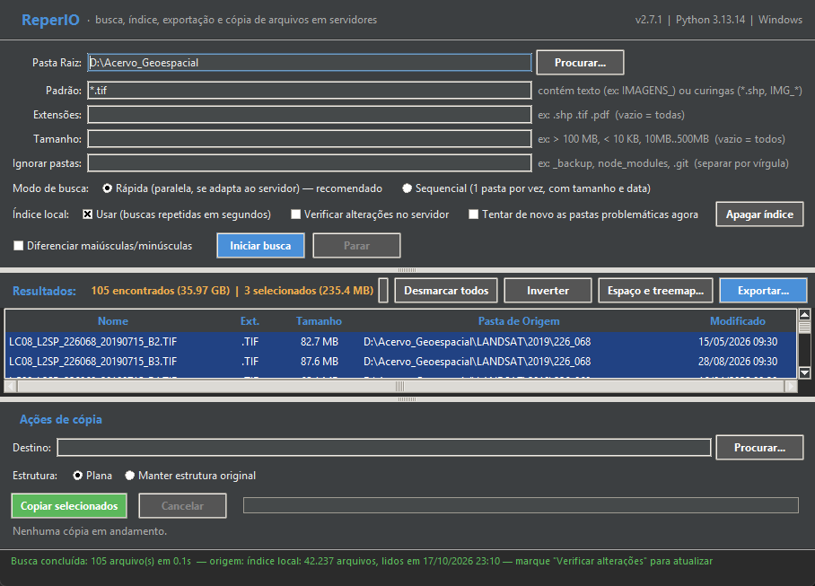
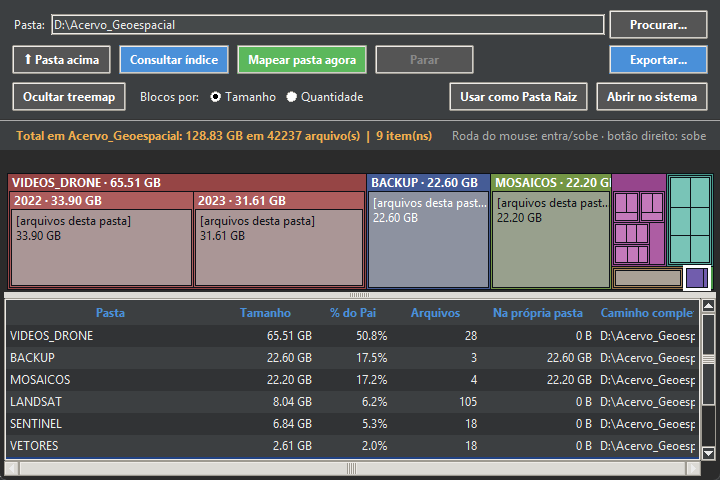
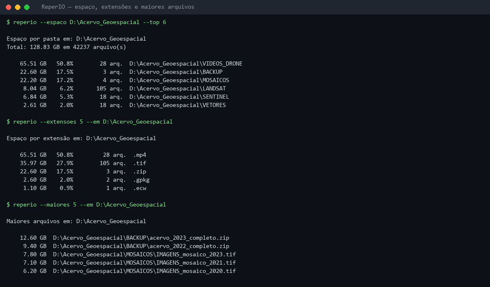
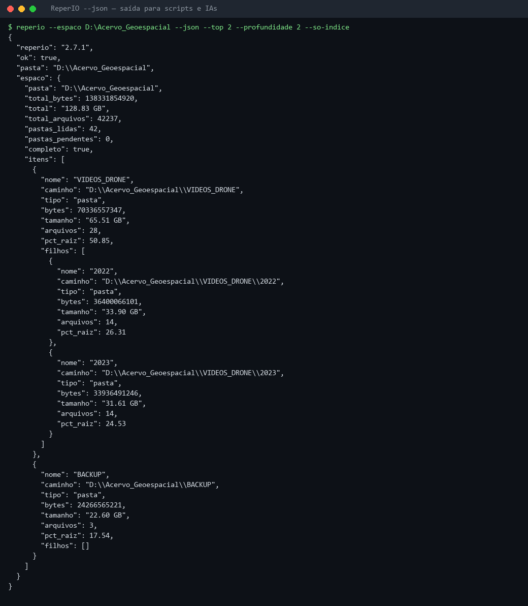

<p align="center">
  
</p>

<h1 align="center">ReperIO</h1>

<p align="center">
  <strong>Encontre, indexe, exporte e copie arquivos em servidores de arquivos grandes e lentos, sem instalar nada</strong><br>
  <em>Busca por nome e extensão · Treemap interativo · Índice local · CLI com JSON para IAs · Excel / CSV / TXT · Cópia paralela · SMB, DFS e unidades mapeadas · Windows e Linux</em>
</p>

<p align="center">
  <a href="https://www.python.org/"></a>
  <a href="#-requisitos"></a>
  <a href="#-por-que-sem-dependências"></a>
  <a href="CHANGELOG.md"></a>
  <a href="LICENSE"></a>
  <a href="https://github.com/Yiuky/ReperIO/actions/workflows/tests.yml"></a>
</p>

<p align="center">
  <a href="https://github.com/Yiuky/ReperIO/releases/latest"><strong>⬇️ Baixar</strong></a> •
  <a href="#️-veja-em-ação"><strong>🖼️ Veja em ação</strong></a> •
  <a href="#-uso-rápido"><strong>📖 Como usar</strong></a> •
  <a href="CHANGELOG.md"><strong>📋 Novidades</strong></a> •
  <a href="https://github.com/Yiuky/ReperIO/issues/new/choose"><strong>🐞 Relatar problema</strong></a> •
  <a href="#-english-abstract"><strong>🌐 English</strong></a> •
  <a href="#-doe-um-café-para-o-dev"><strong>☕ Doe um café</strong></a>
</p>

---

<p align="center">
  
</p>

## 📌 O que faz

O ReperIO responde a três perguntas sobre pastas gigantes, locais ou em **servidor de arquivos de rede**
(SMB/CIFS, DFS, unidades mapeadas):

1. **Onde está o arquivo?** Busca por nome, extensão e tamanho em centenas de milhares de pastas,
   mesmo com servidores que às vezes param de responder.
2. **Onde foi parar o espaço?** Tamanho de cada pasta e subpasta, com **treemap interativo** (estilo
   SpaceSniffer) por tamanho ou por quantidade de arquivos.
3. **Como automatizar?** Linha de comando com **saída JSON estável**, pronta para scripts, tarefas
   agendadas e **IAs**.

Os achados formam o seu **repertório**: filtre, ordene, **exporte para Excel, CSV ou TXT** e **copie
em lote**. Foi criado para bancos de imagens e dados geográficos (GIS), mas serve a qualquer acervo grande.

> Projeto **pessoal e independente** de Joberth Firmino Gambati: não é um produto oficial de nenhuma
> instituição nem fala em nome dela.

## 🖼️ Veja em ação

Todas as imagens abaixo usam um acervo **fictício** (≈ 129 GB, 42 mil arquivos), gerado por
[`tools/screenshots.py`](tools/screenshots.py).

### Busca e filtros

<p align="center">
  
</p>

Digite o padrão, filtre por extensão, tamanho e pastas ignoradas e clique em **Iniciar busca**. Os
resultados aparecem enquanto a busca acontece; o contador mostra o volume encontrado e o selecionado.

### Espaço por pasta com treemap interativo

<p align="center">
  
</p>

**Espaço e treemap...** abre um painel com o **treemap acima da tabela, na mesma janela**. A área de cada
bloco é proporcional ao **tamanho**: aqui, `VIDEOS_DRONE` ocupa metade do acervo.

<p align="center">
  
</p>

Em **Blocos por: Quantidade** o mesmo acervo muda de cara: `TILES_WEB` tem 42 mil arquivinhos e pesa
menos de 1 GB. É o tipo de pasta que deixa a busca, a cópia e o backup lentos sem ocupar espaço.

| Ação | Resultado |
|---|---|
| **Passar o mouse** | Destaca o bloco e mostra caminho, tamanho, arquivos e participação |
| **Clicar** | Seleciona o bloco; a linha da tabela acompanha (e vice-versa) |
| **Duplo clique** ou **roda do mouse para cima** | Entra na pasta sob o mouse |
| **Roda para baixo**, **botão direito** ou **Backspace** | Sobe um nível |
| **Blocos por: Tamanho / Quantidade** | Troca a métrica |
| **Ocultar treemap** | Esconde o painel e deixa só a tabela |
| **Exportar... → Treemap (página HTML)** | Grava uma página autônoma, sem internet |

A página HTML (também gerada por `--treemap mapa.html`) funciona em qualquer navegador, tem tema claro e
escuro e alterna entre tamanho e quantidade:

<p align="center">
  
</p>

### Fluido e responsivo

A interface nunca trava (leitura de disco e rede ficam fora da thread da janela), o treemap se
redesenha ao redimensionar, e **nenhum botão some ao reduzir a janela**: o tamanho mínimo é calculado
a partir do que os controles realmente pedem (fonte e escala do sistema), e um teste automático
confere isso em vários tamanhos.

<p align="center">
  
  &nbsp;
  
</p>
<p align="center"><em>As duas janelas no menor tamanho permitido: tudo continua visível e clicável.</em></p>

### Linha de comando e IAs

<p align="center">
  
</p>

Com `--json`, a CLI entrega **um único objeto JSON** no stdout (mensagens vão para o stderr), com
campos estáveis, códigos de saída fixos e `--manifesto` para uma IA descobrir tudo sozinha:

<p align="center">
  
</p>
<p align="center"><em>Trecho simplificado: a saída real traz mais campos (veja <a href="docs/CLI.md#formato-do-json">docs/CLI.md</a>).</em></p>

## 💡 Por que "ReperIO"

Do latim ***reperire***, "achar, descobrir, trazer à luz", a mesma raiz de ***repertório***
(*répertoire*, *repertoire*, *repertorium*) em quase todas as línguas ocidentais. É o que o programa
faz: **acha** os arquivos e compõe o **repertório** do que foi encontrado. O **IO** final lembra
*input/output*: entrada e saída de dados, o servidor que é lido e a cópia e a exportação que saem dele.

## ✨ Recursos

| | |
|---|---|
| 🔎 **Busca e filtros** | "Contém" (`IMAGENS_`) ou curingas (`*.shp`, `LC08_*_B4.TIF`), extensões, **tamanho** (`> 100 MB`, `10MB..500MB`) e **exclusão de pastas** (`_backup, node_modules`) |
| 🗺️ **Treemap interativo** | Blocos proporcionais ao **tamanho** ou à **quantidade de arquivos**, com dica ao passar o mouse, seleção sincronizada com a tabela e zoom pela roda do mouse; exporta para HTML |
| 📊 **Espaço por pasta** | Quanto cada pasta e subpasta ocupa (com `%`, quantidade de arquivos, navegação, pausa/retomada do mapeamento e exportação) |
| 🤖 **CLI para IAs e scripts** | `--json` estável, `--so-indice` (nunca varre o disco), `--manifesto`, códigos de saída fixos; ações `--espaco`, `--maiores`, `--extensoes`, `--buscar`, `--treemap`, `--status` |
| ⚡ **Rápido em pastas enormes** | Leitura em paralelo e em lotes grandes por ida ao servidor (~3× mais rápido em pastas com 65 mil arquivos); 869 mil arquivos indexados em ~85 s ([benchmark](docs/BENCHMARK.md)) |
| 🗂️ **Índice local e compartilhável** | A 2ª busca na mesma pasta sai em segundos, com qualquer padrão e até com o servidor fora do ar; indexação agendada via CLI (`--indexar`) |
| 🛡️ **Não trava** | Uma pasta que o servidor não consegue abrir não segura a busca: o ReperIO troca de conexão e trata a pasta à parte |
| 📐 **Responsivo** | Nenhum botão some ao redimensionar; tamanho mínimo calculado pelo conteúdo e coberto por teste automático |
| 📤 **Exportar** | Resultados e relatórios de espaço para **Excel (.xlsx)**, **CSV** ou **TXT**, sem precisar do Excel para gerar |
| 📋 **Cópia paralela** | 4 cópias simultâneas, em blocos de 1 MB, com cancelamento a qualquer momento e nomes repetidos renomeados |
| 💻 **Portátil** | Executável único para Windows e Linux; sem instalação, sem administrador, sem `pip` |

## 💻 Requisitos

| Sistema | Como rodar | Requisitos |
|---|---|---|
| **Windows 10/11 (64 bits)** | `ReperIO.exe` | nenhum |
| **Linux x64** | `./ReperIO` | glibc 2.35+ (Ubuntu 22.04+, Debian 12+, Fedora 36+…) |
| **macOS e outros** | [código-fonte](#-rodar-a-partir-do-código-fonte) | Python 3.8+ com tkinter |

A CLI (`--json`, `--espaco`, `--buscar`…) roda só com **Python 3.8+**, sem tkinter, inclusive em servidores
sem interface gráfica.

## ⚡ Instalação

1. Baixe o `.zip` do seu sistema em **[Releases](https://github.com/Yiuky/ReperIO/releases/latest)**:
   - `ReperIO-<versão>-windows-x64.zip`
   - `ReperIO-<versão>-linux-x64.zip`
2. Extraia em qualquer pasta (área de trabalho, pendrive, rede). **Não precisa instalar.**
3. Abra:
   - **Windows:** `iniciar.bat` (ou direto o `ReperIO.exe`)
   - **Linux:** `./iniciar.sh` (ou direto o `./ReperIO`)

O lançador usa o Python 3 com tkinter da máquina, se houver (ArcGIS Pro, python.org, `python3` do
Linux); caso contrário, abre o executável. Nos dois casos, nada é baixado nem instalado.

> [!NOTE]
> Na primeira execução o Windows pode mostrar o aviso do **SmartScreen** (o executável não é assinado
> digitalmente): **Mais informações → Executar assim mesmo**. Se o antivírus corporativo bloquear o
> `.exe` (falso positivo comum em programas empacotados com PyInstaller), peça a liberação à TI ou
> rode pelo código-fonte. Confira a integridade do download com o `SHA256SUMS.txt` da Release.

## 🚀 Uso rápido

1. **Pasta Raiz:** onde buscar. Aceita unidade mapeada (`Y:\Imagens`), caminho de rede
   (`\\servidor\dados`) ou pasta local (`C:\Users\voce`).
2. **Padrão:** texto contido no nome (`IMAGENS_`) ou curingas (`*.tif`, `LC08_*_B4*`).
3. **Extensões** (opcional): `.shp .tif .pdf`, separadas por espaço ou vírgula.
4. **Tamanho** (opcional): `> 100 MB`, `1,5 GB`, `< 10 KB` ou faixa `10MB..500MB`.
5. **Ignorar pastas** (opcional): `_backup, MOSAICOS, node_modules, .git`, separadas por vírgula.
6. **Iniciar busca.** Os resultados aparecem enquanto a busca acontece. Clicar em *Iniciar busca* de
   novo troca o padrão sem perder o que já foi lido.
7. Na lista de resultados:
   - **Duplo clique** em um arquivo abre a pasta dele no sistema já destacando o arquivo;
   - **Espaço e treemap...** abre o painel de [espaço por pasta com treemap](#espaço-por-pasta-com-treemap-interativo);
   - **Exportar...** salva a lista em Excel, CSV ou TXT; ou
   - informe o **Destino** e clique **Copiar selecionados**. *Plana* coloca tudo numa pasta;
     *Manter estrutura original* reproduz as subpastas.

Clique no cabeçalho de uma coluna para ordenar. A barra inferior mostra o andamento e, numa segunda
linha, avisos: pastas lentas, troca de conexão e pastas que não puderam ser lidas (clique para ver a
lista e o motivo).

**Modos de busca:** **Rápida** (padrão: várias pastas em paralelo, com concorrência que se adapta ao
servidor) ou **Sequencial** (uma pasta por vez, para servidores muito frágeis).

## 📤 Exportar resultados

O botão **Exportar...** grava todos os resultados, ou só os selecionados, na ordem da lista:

| Formato | Conteúdo | Ideal para |
|---|---|---|
| **Excel (.xlsx)** | Nome, extensão, tamanho (número e legível), data de modificação (data real), pasta e caminho; cabeçalho congelado e filtro | Analisar, filtrar e compartilhar |
| **CSV** | As mesmas colunas, separadas por `;`, em UTF-8 com BOM | Excel em português, LibreOffice, QGIS, scripts |
| **TXT** | Um caminho completo por linha | Scripts, `robocopy`, listas de cópia |

- O `.xlsx` é gerado pelo próprio ReperIO, sem Excel e sem bibliotecas extras, e abre no Excel, no
  LibreOffice e no Google Planilhas.
- O CSV usa `;`, padrão do Excel em português; num Windows em inglês, prefira o `.xlsx`.
- Nomes que começam com `=`, `+`, `-` ou `@` são neutralizados no CSV, contra injeção de fórmulas.

## 🗂️ Índice local e linha de comando (CLI)

Toda busca grava num índice local todos os arquivos de cada pasta lida, não só os que casaram com o
padrão ou filtro de tamanho. Na busca seguinte:

| Situação | O que acontece |
|---|---|
| Pasta já indexada por completo | Resultados e **Espaço por pasta** em segundos, **sem tocar no servidor**, com qualquer padrão |
| Busca ou mapeamento interrompido | O que já foi lido sai do índice na hora; a varredura **continua exatamente de onde parou** |
| **Verificar alterações no servidor** marcado | Confere a data de cada pasta e **relê só as que mudaram**; arquivos e pastas novos entram, apagados saem |

- ~45 MB de índice por milhão de arquivos; uma busca no índice leva ~3 s por milhão.
- **Apagar índice** limpa tudo; desmarque **Usar** para ignorá-lo numa busca.
- Fica em `%LOCALAPPDATA%\reperio\` (Windows) ou `~/.local/state/reperio/` (Linux), ou no caminho
  informado com `--indice <arquivo.sqlite>` (útil para compartilhar um índice na rede).

### Modo sem janela (CLI), para scripts e IAs

```bash
python reperio.py --indexar "\\servidor\dados" --indice "\\servidor\dados\_reperio.sqlite"
python reperio.py --espaco "C:\Users\voce" --top 25 --exportar espaco.xlsx
python reperio.py --maiores 20 --em D:\ --so-indice          # 20 maiores arquivos, sem tocar o disco
python reperio.py --extensoes 10 --em D:\ --so-indice        # espaço por extensão
python reperio.py --buscar "*.iso" --em D:\ --tamanho "> 1 GB" --json
python reperio.py --espaco D:\ --treemap mapa.html           # mapa visual em HTML
python reperio.py --manifesto                                # a CLI descrevendo a si mesma, em JSON
```

| Ideia | Como |
|---|---|
| Saída para máquinas | `--json`: um objeto JSON em ASCII no stdout; progresso e avisos no stderr |
| Nunca varrer sem querer | `--so-indice`: sem dados no índice, termina com código **3** |
| Descobrir sozinha | `--manifesto`: argumentos, campos de saída, códigos e exemplos em JSON |
| Códigos de saída | `0` ok · `1` erro · `2` uso incorreto · `3` pasta/índice ausente · `130` Ctrl+C |
| Erro de digitação | Argumento desconhecido é erro de uso: a janela **não** abre por engano |

O ReperIO **só lê**: nenhuma ação da CLI apaga, move ou altera arquivos. Referência completa em
[docs/CLI.md](docs/CLI.md); guia e receitas para agentes em [docs/IA.md](docs/IA.md); números medidos
em discos reais em [docs/BENCHMARK.md](docs/BENCHMARK.md).

## 🛡️ Confiável em redes lentas e instáveis

Em servidores de arquivos Windows, **uma única pasta que o servidor não consegue abrir congestiona a
conexão SMB inteira** por vários minutos: tudo o que for pedido por ela espera e falha com timeout
(erro 121). Medimos que o servidor continua respondendo normalmente por **outras conexões**. O
ReperIO aproveita isso:

1. **Várias conexões independentes.** Descobre o servidor real por trás da unidade mapeada e do DFS
   e testa nomes alternativos do mesmo servidor (nome completo, nome completo com ponto final, IP).
   Para o Windows, cada nome é uma conexão separada.
2. **Troca na hora.** Se nenhuma leitura de uma conexão recebe dados por alguns segundos, a busca
   passa para outra e **refaz imediatamente** as pastas que ficaram presas. Pastas grandes que
   continuam recebendo dados não são confundidas com pastas presas.
3. **Quarentena.** A pasta culpada é lida em segundo plano, por uma conexão separada, sem atrasar o
   resto. Se o servidor não responder nem assim, ela entra na lista de **pastas problemáticas**, com o
   motivo para encaminhar à TI, e é tentada de novo automaticamente a cada 12 h.
4. **Respeito ao usuário.** A conexão usada pela unidade mapeada, a mesma do Explorer, **nunca**
   recebe leituras arriscadas: sua navegação no servidor não é afetada.

**Resultado medido** numa árvore real de 3.246 pastas com uma pasta ilegível no servidor: a versão
2.1 travava (36 pastas em 28 min); desde a 2.3, os resultados principais saem em **~1 minuto**, a
árvore inteira é lida e só a pasta ilegível fica de fora, com aviso. A 2ª busca sai do índice em menos
de 1 segundo.

Com uma conexão só (Linux, disco local, servidor sem outros nomes), as pastas que falham por rede vão
para o fim da fila e são tentadas de novo, uma por vez, depois de todo o resto.

## 🐧 Linux e compartilhamentos Windows

No Linux não existe "unidade `Y:`": monte o compartilhamento e busque no ponto de montagem.

```bash
sudo apt install cifs-utils
sudo mkdir -p /mnt/dados
sudo mount -t cifs //SERVIDOR/compartilhamento /mnt/dados \
     -o username=SEU_USUARIO,domain=SEU_DOMINIO,vers=3.0,ro
```

Pelo gerenciador de arquivos (GNOME/KDE), o caminho fica em `/run/user/<uid>/gvfs/...`.

## 🩺 Solução de problemas

<details>
<summary><b>O <code>iniciar.bat</code> diz que não encontrou Python nem o executável</b></summary>

Você baixou o código-fonte em vez do pacote. Baixe o `.zip` de
[Releases](https://github.com/Yiuky/ReperIO/releases/latest), que já inclui o `ReperIO.exe`.
</details>

<details>
<summary><b>Linux: "tkinter não está disponível neste Python"</b></summary>

Instale o tkinter (`sudo apt install python3-tk` ou `sudo dnf install python3-tkinter`) ou use o
executável `./ReperIO` do pacote, que já traz tudo.
</details>

<details>
<summary><b>Algumas pastas aparecem como "não puderam ser lidas"</b></summary>

Clique no aviso amarelo, na base da janela, para ver a lista com a causa de cada uma: acesso negado,
caminho de rede não encontrado, timeout etc. Pastas com timeout que falham por todas as conexões são,
em geral, problema do servidor: arquivo bloqueado, antivírus, disco ou sistema de arquivos. Encaminhe
a lista à TI. Elas são tentadas de novo a cada 12 h, ou já, marcando *Tentar de novo as pastas
problemáticas agora*.
</details>

<details>
<summary><b>A busca parece lenta</b></summary>

Pastas com dezenas de milhares de arquivos levam tempo para serem listadas na primeira vez; da
segunda em diante, o índice responde em segundos. Acompanhe a barra de status e o log (abaixo).
</details>

<details>
<summary><b>Onde fica o log?</b></summary>

- Windows: `%LOCALAPPDATA%\reperio\debug_execution.log`
- Linux: `~/.local/state/reperio/debug_execution.log`

Marcas úteis: `[PROGRESSO]`, `[PASTA LENTA]`, `[CANAL]` (conexões e trocas), `[QUARENTENA]`,
`[REFEITA]`, `[FALHA FINAL]`, `[ÍNDICE]`.

Quem usava a versão 2.4 ou anterior (com o nome antigo "GIS File Finder") tem o índice e o log
migrados automaticamente para a pasta nova.
</details>

## 🧑‍💻 Rodar a partir do código-fonte

Requer **Python 3.8+ com tkinter** e nenhuma biblioteca extra.

```bash
git clone https://github.com/Yiuky/ReperIO.git
cd ReperIO
python reperio.py        # Windows (ou iniciar.bat)
python3 reperio.py       # Linux/macOS (ou ./iniciar.sh)
```

<details>
<summary>Qual Python o <code>iniciar.bat</code> usa</summary>

Nesta ordem, o primeiro que for 3.8+ **e** tiver tkinter:

1. variável de ambiente `REPERIO_PYTHON`
2. `py -3` (Python Launcher do python.org)
3. ArcGIS Pro (`%ProgramFiles%\ArcGIS\Pro\bin\Python\envs\arcgispro-py3`)
4. `%LOCALAPPDATA%\Programs\Python\Python3*` e `%ProgramFiles%\Python3*`
5. `python` no PATH

Cada candidato é testado de verdade e executado em modo isolado (`-I`), para que variáveis deixadas
pelo ArcGIS 10.x (Python 2.7) não interfiram. O Python do QGIS não traz tkinter e é ignorado.
</details>

### Por que sem dependências?

Muitos usuários estão em máquinas corporativas onde instalar pacotes nem sempre é permitido. Por isso
o ReperIO usa **somente a biblioteca padrão do Python**: interface em `tkinter`, índice em `sqlite3`,
listagem rápida via `ctypes` (Windows) e Excel escrito com `zipfile`.

## 🏗️ Arquitetura

```
reperio.py            aplicativo completo, arquivo único (busca, índice, conexões, exportação, interface)
iniciar.bat / .sh     lançadores: Python da máquina, senão o executável
tests/                testes automatizados (unittest; cenários de rede simulados, CLI e treemap)
docs/                 CLI.md, IA.md (uso por agentes) e BENCHMARK.md
tools/benchmark.py    mede varredura e consultas pela CLI (discos C:/D:)
tools/build.py        gera o executável (PyInstaller) e o .zip de distribuição
tools/screenshot.py   gera a imagem do README com dados de demonstração
tools/make_logo.ps1   gera o logo; tools/make_icon.py monta o ícone .ico
.github/              testes (Windows/Linux), Release automática, modelos de issue e PR
```

Regras que mantêm a interface fluida e o servidor saudável, detalhadas no [AGENTS.md](AGENTS.md):
nenhum I/O de rede na thread da interface; threads conversam por filas; leituras arriscadas nunca
passam pela conexão do usuário.

## 🧪 Testes

```bash
python -m unittest discover -s tests -v          # Windows
xvfb-run -a python3 -m unittest discover -s tests -v   # Linux sem tela
```

96 testes, incluindo a simulação dos cenários vistos em servidor real: pasta que trava a conexão,
vítimas refeitas na hora, cascata entre conexões, pastas grandes que não são travamento, nomes
inválidos de servidores Samba antigos, filtros de tamanho/exclusão, análise de espaço por pasta, treemap, CLI/JSON e
exportação com datas corrompidas. O GitHub Actions roda a suíte em Windows e Linux, com Python 3.8 e
3.13, a cada push.

## 📦 Publicar uma versão (mantenedor)

1. Atualize `__version__` em `reperio.py`, o [CHANGELOG](CHANGELOG.md) e o `CITATION.cff`.
2. `git tag vX.Y.Z && git push origin vX.Y.Z`.
3. O GitHub Actions roda os testes, compila `ReperIO.exe` (Windows) e `ReperIO` (Linux), monta os
   `.zip` e publica a Release com o `SHA256SUMS.txt`.

## 🤝 Contribuindo

Ideias, relatos de erro e pull requests são bem-vindos: veja o [guia de contribuição](CONTRIBUTING.md),
o [roadmap](BACKLOG.md) e o [código de conduta](CODE_OF_CONDUCT.md). Falhas de segurança: siga a
[política de segurança](SECURITY.md).

## 📝 Como citar

Se o ReperIO ajudou num trabalho, cite-o pelo botão **"Cite this repository"** do GitHub (gerado a partir
do [CITATION.cff](CITATION.cff)) ou assim:

> Gambati, J. F. (2026). *ReperIO: busca, índice, exportação e cópia de arquivos em servidores* (versão
> 2.6.0) [Software]. https://github.com/Yiuky/ReperIO

## 🌐 English Abstract

**ReperIO** (from Latin *reperire*, "to find, to discover", the root of *repertory*) is a portable,
dependency-free desktop tool for **Windows and Linux** that searches local folders and **network file
servers** (SMB/CIFS, DFS, mapped drives) for files by name, extension and size, analyzes **disk/folder
space usage** with an interactive **treemap** (by size or by file count), builds a local **SQLite index**
for instant repeated searches, **exports** results to Excel (.xlsx), CSV or TXT, and **copies** files in
parallel. A headless **CLI with stable JSON output** (`--json`, `--so-indice`, `--manifesto`, fixed exit
codes) makes it ready for scripts, scheduled tasks and AI agents; the UI never hides a button when the
window is resized.

It was built for very large, slow and unreliable file servers. On Windows, a single folder that the
server cannot open stalls the whole SMB connection for minutes; ReperIO opens **several independent
connections** to the same server (FQDN, FQDN with trailing dot, IP), **switches connection** as soon as
one stops making progress, **re-issues stuck reads immediately**, and reads the culprit folder in
**quarantine** on a separate connection, never on the user's own (Explorer) connection. On a real tree
of 3,246 folders with one unreadable folder, results arrive in about **one minute** instead of
stalling, and repeated searches come from the index in under a second.

Single-file Python 3.8+ application using only the standard library (tkinter, sqlite3, ctypes,
zipfile), with standalone executables built by PyInstaller. MIT License.

## ☕ Doe um café para o dev

O ReperIO é gratuito e de código aberto, desenvolvido nas horas vagas. Se ele economizou o seu tempo,
considere pagar um café para o desenvolvedor: ajuda a manter o projeto vivo e a trazer novos recursos.

<table>
  <tr>
    <td align="center"></td>
    <td>
      <strong>Pix</strong> (qualquer valor)<br><br>
      Chave aleatória:<br>
      <code>fcf8071f-416d-49f1-b4b9-3188d3d03c4b</code><br><br>
      Pix copia e cola:<br>
      <code>00020101021126580014br.gov.bcb.pix0136fcf8071f-416d-49f1-b4b9-3188d3d03c4b5204000053039865802BR5917JOBERTH F GAMBATI6006CUIABA62070503***63048088</code><br><br>
      <em>Favorecido: Joberth Firmino Gambati</em>
    </td>
  </tr>
</table>

## 👤 Autor e licença

- **Desenvolvedor:** Joberth Firmino Gambati ([@Yiuky](https://github.com/Yiuky))
- **Licença:** [MIT](LICENSE)
- Projetos relacionados: [ArcMagery](https://github.com/Yiuky/ArcMagery-releases), imagens de satélite no ArcMap 10.8.
